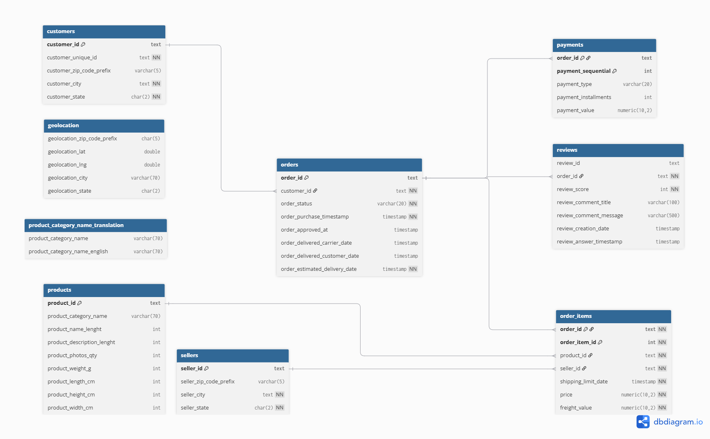

# Olist E-commerce SQL Project

> **An end-to-end Data Analyst project using PostgreSQL to investigate customer retention in the Brazilian e-commerce marketplace.**

## Project Overview

This project explores the Olist Brazilian E-commerce Public Dataset and demonstrates an end-to-end analytical workflow, from preparing and validating data to investigating a business problem and communicating evidence-based findings.

I designed a relational database in PostgreSQL, imported and profiled the source data, validated relationships and data quality, established a business health baseline, and conducted a focused analysis of customer repeat-purchasing behaviour.

The central business question is:

**How can Olist improve customer retention and encourage more first-time buyers to make a second purchase?**

The project combines SQL and database development with business-oriented analysis. It also documents the decisions, definitions, and limitations behind the work.

---

## Business Problem

Olist has a large delivered customer base, but very few customers make another purchase.

Of the **93,358 delivered customers** included in the retention analysis, only **2,565 made more than one distinct purchasing occasion**. This represents a repeat customer rate of approximately **2.75%**.

The largest drop-off occurs between the first and second purchases. This makes the conversion of first-time buyers into repeat customers the primary retention opportunity identified in this analysis.

The objective is not simply to report the repeat-purchase rate, but to investigate purchasing patterns, examine whether first-purchase characteristics or geography reveal useful differences, and identify what should be investigated next.

## Project Objectives

- Build a reliable relational database for the Olist marketplace dataset.
- Profile and validate source data before using it for analysis.
- Define business metrics and establish a baseline of marketplace performance.
- Measure repeat purchasing and examine the progression from first to subsequent purchases.
- Explore first-purchase characteristics and geographic differences across customer groups.
- Translate the findings into practical business implications and further questions.

---

## Key Business Findings

The retention analysis focuses on delivered customers and distinct purchasing occasions.

| Finding | Result | SQL Reference |
|---|---:|---|
| Delivered customers | 93,358 | [Query 1](sql/3.Analysis/06_customer_retention_analysis.sql#L34-L80) |
| Customers with more than one purchasing occasion | 2,565 | [Query 2](sql/3.Analysis/06_customer_retention_analysis.sql#L34-L80) |
| Repeat customer rate | **~2.75%** | [Query 2](sql/3.Analysis/06_customer_retention_analysis.sql#L34-L80) |
| Customers reaching a third purchasing occasion | 202 | [Query 3](sql/3.Analysis/06_customer_retention_analysis.sql#L267-L321) |
| Second-to-third purchase transition | 7.88% | [Query 3](sql/3.Analysis/06_customer_retention_analysis.sql#L267-L321) |
| Median time to second purchase, among returning customers | **41 days** | [Query 4](sql/3.Analysis/06_customer_retention_analysis.sql#L87-L136) |
| Average time to second purchase, among returning customers | 88.86 days | [Query 4](sql/3.Analysis/06_customer_retention_analysis.sql#L87-L136) |


**Note:** This analysis focuses on delivered customers and distinct purchasing occasions. Multiple order IDs with the same purchase timestamp are treated as one purchasing occasion.

### What the findings indicate

1. **The main drop-off is after the first purchase.** Approximately 2.75% of delivered customers made another distinct purchasing occasion. The first-to-second purchase transition is therefore the main retention opportunity identified by the analysis.
2. **Returning customers do not follow one consistent timeline.** Among customers who returned, the median time to the second purchase was 41 days, while the average was 88.86 days. The higher average indicates that some customers took considerably longer to return.
3. **The first-purchase characteristics examined did not explain the retention gap.** Product category, basket size, first-order value, delivery duration, and review score did not show strong or consistent differences between one-time and repeat customers.
4. **The geographic analysis did not reveal a substantial state-level pattern.** Major customer states had relatively similar repeat-purchase rates. Higher rates in some smaller states should be interpreted cautiously because their customer bases were much smaller.

These are observed patterns, not proof of what causes customers to return or not return. The available dataset does not establish why most customers did not make another purchase.

### Business implications and recommended next steps

The analysis suggests that Olist should prioritize understanding and improving first-to-second purchase conversion. Possible next steps include:

- Investigate first-time customer behaviour using additional customer feedback and behavioural data.
- Test targeted follow-up campaigns or second-purchase incentives, measuring both conversion and incremental profitability.
- Examine competitor offerings, pricing, loyalty initiatives, and broader market behaviour.
- Develop a customer lifetime value (CLV) framework using suitable revenue, margin, and cost data.

The immediate priority is to test which interventions encourage sustainable and profitable repeat purchasing—not to assume that a particular product, delivery experience, or location is the cause of low retention.

---

## Analytical Workflow

The project follows a structured workflow:

```text
Source Datasets
      |
      v
Understand and Profile the Data
      |
      v
Relational Database Design
      |
      v
Create PostgreSQL Tables
      |
      v
Import and Validate Data
      |
      v
Business Health Assessment
      |
      v
Define the Retention Problem
      |
      v
Customer Retention Analysis
      |
      v
Interpret Findings and Limitations
      |
      v
Business Implications and Next Steps
```

This workflow emphasizes building a reliable analytical foundation before drawing conclusions from the data.

## Dataset

**Dataset:** [Brazilian E-Commerce Public Dataset by Olist](https://www.kaggle.com/datasets/olistbr/brazilian-ecommerce)

The dataset contains information about the Olist marketplace, including:

- Customers
- Orders
- Sellers
- Products
- Product categories and category translations
- Payments
- Reviews
- Geolocation
- Order items

The PostgreSQL database contains **nine related tables** designed to support analysis of the marketplace.

---

## Tools & Technologies

- **PostgreSQL** — relational database and SQL analysis
- **pgAdmin 4** — database administration
- **SQL** — data profiling, validation, joins, aggregations, and analysis
- **Git and GitHub** — version control and project hosting
- **Visual Studio Code** — SQL development and project documentation

## Skills Demonstrated

### SQL and Data Analysis

- Data retrieval and filtering
- Joins and aggregations
- GROUP BY and HAVING
- Common Table Expressions (CTEs)
- Business metric definition
- Customer repeat-purchase analysis
- Comparative and geographic analysis
- Translating analytical results into business findings

### Database Design

- Relational database design
- Schema design and entity relationships
- Primary and composite primary keys
- Foreign key constraints
- Entity Relationship Diagram (ERD)

### Data Quality and Validation

- Data profiling
- Missing-value analysis
- Duplicate detection
- Business-rule validation
- Timestamp validation
- Cross-table validation

### Business Analysis and Documentation

- Business problem framing
- KPI-based business health assessment
- Analytical prioritization
- Interpretation of findings and limitations
- Business implications and recommended next steps
- Learning and decision documentation

---

## Database Schema

The PostgreSQL database contains nine related tables representing different parts of the Olist marketplace.

| Table | Description |
|---|---|
| `customers` | Customer information |
| `orders` | Order details |
| `sellers` | Seller information |
| `products` | Product information |
| `product_category_name_translation` | Product category translations |
| `geolocation` | ZIP code geolocation data |
| `payments` | Payment information |
| `reviews` | Customer reviews |
| `order_items` | Products within each order |

### Entity Relationship Diagram

The diagram below represents the implemented PostgreSQL database schema.



---

## Project Structure

```text
Olist_Ecommerce_SQL_Project/
|
├── data/       # Source data (not necessarily tracked in Git)
├── docs/       # Project documentation and analysis write-ups
├── images/     # ER diagram and project visuals
├── output/     # Selected analysis outputs
├── sql/        # SQL scripts for database work and analysis
├── README.md
└── .gitignore
```

## Project Documentation

The documentation records the implementation, analytical decisions, and conclusions reached during the project.

| Document | Purpose |
|---|---|
| [Learning Log](docs/01_learning_log.md) | Concepts and analytical thinking developed during the project |
| [Decision Log](docs/02_decision_log.md) | Important project decisions and their reasoning |
| [Business Health Report](docs/05_business_health_report.md) | KPI-based assessment of marketplace performance |
| [Business Insights: Customer Retention](docs/06_business_insights.md) | Business problem, retention findings, limitations, and recommended next steps |


---

## SQL Files

The `sql/` directory contains the SQL scripts used throughout the project, organized by their purpose and analysis stage.

### 1. Database Setup
Scripts used to create the database structure and prepare the dataset for analysis.

### 2. Data Profiling
Scripts used to examine individual tables, understand the dataset, and identify data quality issues such as missing values, duplicates, and inconsistencies.

### 3. Business Analysis
Contains the SQL queries used to investigate business performance and customer retention.

**Main analysis file:**
- [`SQL analysis file: Customer Retention`](sql/3.Analysis/06_customer_retention_analysis.sql) – Contains 10 organized SQL queries covering repeat purchasing behavior, time to second purchase, purchase patterns, first-purchase characteristics, delivery experience, and customer geography.

### 4. Business Insights
The business findings and recommendations derived from the SQL analysis are documented separately in:

- [`docs/06_final_insights.md`](docs/06_final_insights.md)

This document presents the business interpretation of the findings rather than simply listing query results.


---


## Project Status

<details>
<summary><strong>Phase 1 — Database Development</strong> (Completed)</summary>

- Relational database design
- PostgreSQL table creation
- Data import
- Data profiling
- Data validation
- Entity Relationship Diagram
- Database documentation

</details>

<details>
<summary><strong>Phase 2 — Business Health Assessment</strong> (Completed)</summary>

- Business KPI definition
- Business Health Report
- Initial business observations
- Identification of the next analytical focus

</details>

<details>
<summary><strong>Phase 3 — Customer Retention Analysis</strong> (Completed)</summary>

- Defined repeat-purchase metrics and analysis population
- Examined customer purchase progression
- Analyzed time to second purchase
- Compared first-purchase characteristics of one-time and repeat customers
- Examined geographic differences in repeat purchasing
- Documented findings, limitations, and recommended next steps

</details>

## Future Improvements

Potential extensions to this project include:

- Build an interactive Power BI dashboard to communicate the business health and retention findings.
- Incorporate additional customer, marketing, and behavioural data to investigate why customers do not return.
- Evaluate retention experiments using conversion and incremental profitability measures.
- Develop a customer lifetime value framework when suitable revenue, margin, and cost data are available.

These are potential extensions; they are not presented as completed analysis.

---

## About Me

I'm a B.Tech graduate building a career in Data Analytics.

I enjoy understanding business problems through data and improving my analytical skills by working on practical projects with real-world datasets.

Through this project, I worked with PostgreSQL and SQL to build an analytical database, validate data, define business metrics, investigate customer behaviour, and communicate findings in a business context.

I'm actively seeking entry-level opportunities in Data Analytics, Business Intelligence, MIS Reporting, and Operations Analytics.

---

**Thank you for visiting this repository!**
